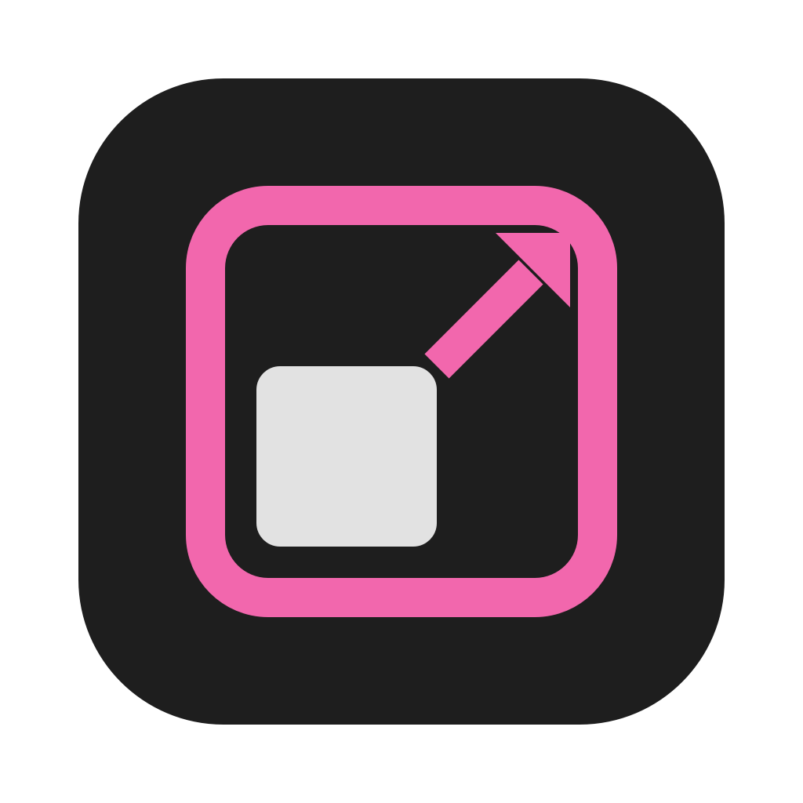

<p align="center"></p>

# mSIZER

[](https://openmacapps.com/apps/msizer/) [](https://github.com/starbudweiser/mSIZER/releases/latest) [](LICENSE)

Batch photo editor for macOS: resize, crop, rotate, retouch, watermark, rename and convert hundreds of photos in a few clicks. A personal, simplified alternative to [Photo Bulk Editor](https://photobulkeditor.com/).

🇬🇧 English · 🇫🇷 [Français](#français)

## About

mSIZER is made by Starbudweiser & Claude Code (Anthropic). MIT License, © 2026 Starbudweiser. Provided as is, without warranty: keep a copy of your originals before replacing them. Inspired by Photo Bulk Editor, not affiliated with it. See "About mSIZER" in the app menu.

## Features

- Drop photos or folders, see a live before/after preview of the selected photo.
- Resize (long side, width, height, percentage, fit in a box, fill a box), never enlarge, Lanczos quality.
- Crop to a ratio (1:1, 4:3, 3:2, 16:9, 4:5, 9:16 or custom) with a chosen anchor.
- Manual crop with free handles on the preview (optional ratio lock, one framing per photo, "apply to all").
- Rotate 90°/180°, flip, EXIF orientation applied automatically.
- Adjustments: auto enhance, brightness, contrast, saturation, sharpness, black and white.
- Watermark: text or logo, nine positions, size and opacity.
- Output: JPEG, PNG, HEIC, TIFF or same as source; quality slider; **maximum file size** (quality adapts automatically); sRGB conversion.
- Metadata: keep, remove GPS location only, or erase everything.
- Rename with a pattern (`{name}`, `{n}`, `{date}`, `{w}`, `{h}`).
- Destination: `mSIZER` subfolder, another folder, or replace the originals (they go to the Trash). Existing files are never overwritten.
- Presets (Web, E-mail, Instagram, thumbnails, privacy…) and your own saved presets.
- Output formats: JPEG, PNG, WebP, HEIC, AVIF, JPEG 2000, TIFF, GIF, BMP, TGA, PSD, PDF, OpenEXR, ICO, ICNS (WebP through a statically linked libwebp; build needs `brew install webp`).
- Social network presets (Instagram, Facebook, X, LinkedIn, YouTube, TikTok, Pinterest, Snapchat, WhatsApp, Discord, Twitch): posts, stories, profile pictures, banners at the exact size.
- Languages: French, English, Spanish, Italian (follows the system language). Interface follows the Socle design system.
- Automatic updates from GitHub releases (signature checked, never during a batch), with a manual check button.

### Apple Silicon

Apple Silicon only (arm64, tuned for the M family). Filters run on the GPU through Core Image / Metal, JPEG and HEIC decoding is hardware accelerated and reduced by the decoder when possible, and photos are processed in parallel on the performance cores only.

## Install

**[Download the latest notarized release](https://github.com/starbudweiser/mSIZER/releases/latest)**, unzip it and move **mSIZER.app** to your Applications folder. Requires **macOS 15 Sequoia on Apple Silicon** or later.

## Build

```bash
./build_app.sh     # builds, signs and installs ~/Applications/Applications Personnelles/mSIZER.app
./tests/run_tests.sh
```

Requires macOS 15 or later and the Swift toolchain.

## Languages

English, French, Spanish and Italian. The app follows your Mac's preferred language automatically (English if it is none of these four).

## Support

Bug reports and suggestions: [GitHub Issues](https://github.com/starbudweiser/mSIZER/issues).

## License

Released under the **MIT License**, © 2026 Starbudweiser. See [LICENSE](LICENSE).

---

## Français

Éditeur de photos par lots pour macOS : redimensionner, recadrer, pivoter, retoucher, filigraner, renommer et convertir des centaines de photos en quelques clics. Une alternative personnelle et simplifiée à Photo Bulk Editor, sans lien avec lui.

- Aperçu avant/après en direct, redimensionnement Lanczos, recadrage par ratio ou à la main, réglages, filigrane texte ou logo.
- Nombreux formats de sortie (JPEG, PNG, WebP, HEIC, AVIF, TIFF, PDF…), taille de fichier maximale, métadonnées conservées ou effacées.
- Préréglages (web, e-mail, réseaux sociaux) et préréglages personnels. Gardez une copie de vos originaux avant de les remplacer.
- Apple Silicon uniquement (filtres sur le GPU, traitement parallèle).

Installation : téléchargez la [dernière version notarisée](https://github.com/starbudweiser/mSIZER/releases/latest), décompressez-la et placez **mSIZER.app** dans Applications (macOS 15 Sequoia ou plus récent).

Interface en français, anglais, espagnol et italien, choisie d'après la langue du Mac (anglais sinon). Licence MIT, © 2026 Starbudweiser. Questions et bugs : [Issues GitHub](https://github.com/starbudweiser/mSIZER/issues).
